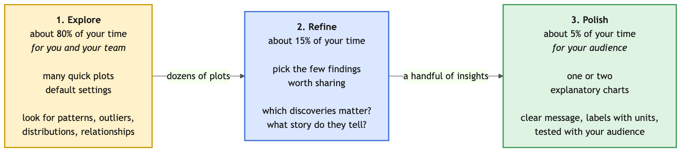

# Exploratory vs Explanatory Visualisation

## Understanding the Two Types of Data Visualization

Data visualization serves two distinct purposes in the data science workflow. Understanding the difference helps you choose the right approach and tools.

Here is the same penguin data drawn both ways. The left chart is for you, while you explore: it plots every penguin with default settings, and that is how you notice that one species sits apart from the others. The right chart is the same plot polished for an audience: the title states the finding, colour highlights the group it is about, and a cross marks each species' average so the finding can be read off the chart.

### **Exploratory Data Analysis (EDA) Visualization**

**Purpose**: To discover patterns, identify outliers, test hypotheses, and understand your data

**Characteristics:**

- Quick and iterative

- Often messy and numerous

- Created for yourself or your team

- Focus on discovery, not presentation

- Multiple variations to explore different aspects

---

**Best Practices for Exploratory Visualization:**

1. **Speed over polish**: Create visualizations quickly to test hypotheses

2. **Create many plots**: Don't be afraid to generate dozens of plots

3. **Use default settings**: Styling is not a priority

4. **Try multiple perspectives**: Same data, different plot types

5. **Look for anomalies**: Outliers, missing data, unexpected patterns

6. **Iterate freely**: Modify and recreate without hesitation

---

### **Explanatory Data Visualization**

**Purpose**: To communicate findings clearly to an audience (stakeholders, readers, the public)

**Characteristics:**

- Carefully designed and polished

- Tell a specific story or answer a specific question

- Created for an external audience

- Focus on clarity and impact

- Minimal, intentional design choices

---

**Best Practices for Explanatory Visualization:**

1. **Clear narrative** : Every plot should answer a specific question

2. **Simplify ruthlessly** : Remove everything that doesn't support your message

3. **Guide attention** : Use color, size, and position to highlight key insights

4. **Professional styling** : Consistent fonts, colors, and formatting

5. **Comprehensive labels** : Descriptive titles, axis labels with units, data sources

6. **Accessibility first** : Colorblind-safe palettes, sufficient contrast

7. **Context matters** : Add annotations, reference lines, or comparisons

8. **Test with audience** : Ensure your message is understood

---

**Recommended Tools:**

- **Matplotlib and Seaborn** for static reports and publications

- **Plotly** for interactive presentations and dashboards

- **Export formats**: SVG for publications, PNG for presentations, HTML for web

For an example see section `4.5 More Comparative Plots   Question 5` in the [Plotting Introduction Notebook](./02_plotting_intro.ipynb).

---

### **The Visualization Workflow**

Most data science projects follow this progression:

1. **Explore** (80% of time): Generate many quick plots to understand your data
   - Use defaults, be messy, iterate rapidly

   - Focus: patterns, outliers, distributions, relationships

   - Be driven by questions you want to answer

2. **Refine** (15% of time): Identify the key insights worth sharing
   - Which discoveries matter most?

   - What story do they tell?

3. **Polish** (5% of time): Create explanatory visualizations
   - Clean design, clear message, professional appearance

   - Test with your target audience

>**Important**: Most visualizations you create will be exploratory. Only a small fraction will become explanatory plots for external audiences. This is normal and expected!
